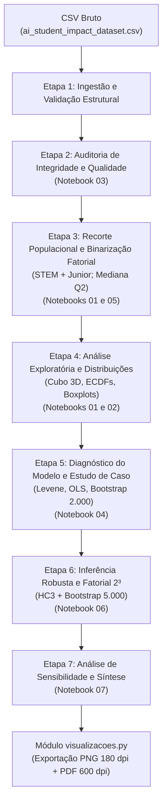

# Detalhamento do Pipeline de Dados e Quantidades de Reprocessamento
**PCC170 — Planejamento e Análise de Experimentos (Entrega 2)**  
*Pasta de referência:* `entrega2-com_notebooks_adaptados/entrega2-com_notebooks_adaptados/notebooks_adaptados/`

---

## 1. Quantidade de Reprocessamento (Reamostragens, Réplicas e Iterações)

No contexto dos notebooks adaptados e do pipeline estatístico da Entrega 2, o termo **reprocessamento** corresponde aos procedimentos iterativos de **reamostragem estatística (*bootstrap*)**, **estratificação**, **permutação** e **análise de sensibilidade**.

Abaixo estão detalhadas as quantidades exatas de reprocessamento implementadas:

### 1.1. Bootstrap por Célula — Médias e IC95% individuais
* **Arquivo:** `04_estudos_de_caso_pcc170_entrega02.ipynb` (Célula 5)
* **Algoritmo:** Sorteio com reposição (*bootstrap*) estratificado por célula fatorial. Para cada uma das 8 células do fatorial $2^3$, é gerada uma matriz de índices aleatórios:
  $$\text{size} = (2000, n_i)$$
  onde $n_i$ é o número real de alunos na célula $i$.
* **Iterações por célula:** **2.000 reamostragens**.
* **Total acumulado:** $8 \text{ células} \times 2.000 = \mathbf{16.000}$ **reamostragens de médias**.
* **Objetivo:** Estimar os quantis empíricos de 2,5% e 97,5% para construir os intervalos de confiança de 95% da média de $\Delta\text{GPA}$ de cada combinação de tratamento.
* **Semente controlada:** `np.random.default_rng(42)`.

---

### 1.2. Bootstrap Estratificado Completo — Efeitos Fatoriais
* **Arquivo:** `06_fatorial_2k_pcc170_entrega02.ipynb` (Célula 7)
* **Algoritmo:** Em cada iteração $b \in \{1, \dots, N_{\text{boot}}\}$, cada uma das 8 células fatoriais é reamostrada com reposição no seu respectivo tamanho original $n_i$. A partir das 8 médias reamostradas $\bar{Y}_b$, recalculam-se os 7 contrastes de Yates ($A, B, C, AB, AC, BC, ABC$):
  $$\text{Efeito} = \frac{1}{4} \sum_{k=1}^{8} \text{sinal}_k \cdot \bar{Y}_k$$
* **Quantidade de iterações (`N_BOOT`):** **5.000 iterações**.
* **Total de reamostragens de células:** $5.000 \times 8 = \mathbf{40.000}$ **amostras bootstrap**.
* **Objetivo:** Obter a distribuição empírica amostral dos 7 efeitos fatoriais e calcular os ICs de 95% (percentis 2,5% e 97,5%), avaliando se o zero está excluído do intervalo.
* **Semente controlada:** `SEED = 42`.

---

### 1.3. Reprocessamentos no Pipeline Integrado e Análises de Sensibilidade
* **Arquivos:** `07_projeto_relatorio_pcc170_entrega02.ipynb` e `pcc170_entrega02.py`
* **Réplicas sintéticas balanceadas (Ciclo 1 / Ilustrativo):**
  * $R = 30$ réplicas por célula com $M = 36$ alunos sorteados com reposição.
  * Total: $8 \times 30 = \mathbf{240}$ observações balanceadas para demonstrar os efeitos da pseudo-replicação na ANOVA clássica.
* **Sensibilidade a Sementes Aleatórias:**
  * O cálculo de efeitos é reprocessado sob **5 sementes diferentes** (`seeds = 42, 1, 2, 3, 4`) para validar a estabilidade numérica dos estimadores bootstrap.
* **Sensibilidade às Regras de Corte:**
  * Todo o pipeline de categorização dos fatores e cálculo de efeitos é reprocessado em **3 regras de corte** alternativas:
    1. Mediana ($Q2$): regra principal inclusiva.
    2. Quartis estritos ($< Q1$ e $\ge Q3$): descarta a metade central dos dados.
    3. Quartis inclusivos ($\le Q1$ e $\ge Q3$).
* **Permutação de Monte Carlo (Apêndice / Inferência Consolidada):**
  * **5.000 permutações aleatórias** (`N_PERM = 5000`) de rótulos para teste de hipótese sob a hipótese nula de independência estocástica.

---

### Tabela-Resumo das Quantidades de Reprocessamento

| Procedimento | Onde ocorre | Qtd. de Repetições / Réplicas | Total de Amostragens | Objetivo Principal |
| :--- | :--- | :--- | :--- | :--- |
| **Bootstrap por célula** | Notebook 04 | 2.000 por célula | 16.000 reamostras | IC95% descritivo das médias de $\Delta\text{GPA}$ |
| **Bootstrap dos efeitos** | Notebook 06 | 5.000 estratificadas | 40.000 reamostras | IC95% inferencial dos 7 contrastes fatoriais |
| **Réplicas sintéticas** | Script principal / NB 07 | 30 por célula ($M=36$) | 240 réplicas | Avaliação didática de balanceamento (ANOVA) |
| **Estabilidade de sementes** | Script principal / NB 07 | 5 sementes | 5 reexecuções | Auditoria de invariância numérica |
| **Sensibilidade a cortes** | Script principal / NB 07 | 3 regras | 3 reclassificações | Robustez dos efeitos frente à dicotomização |
| **Permutação Monte Carlo** | Script principal / Apêndice | 5.000 permutações | 5.000 reajustes | Teste de nulidade não paramétrico |

---

## 2. Detalhamento do Fluxo do Processo: Da Coleta à Geração de Imagens

O pipeline de processamento é estruturado em uma esteira de 7 etapas lógicas, executadas de ponta a ponta pelos notebooks `01` a `07`.



---

### Etapa 1: Ingestão e Leitura dos Dados Brutos
* **Entrada:** Arquivo `csv/ai_student_impact_dataset.csv`.
* **Mecanismo:** Os notebooks buscam recursivamente a pasta `csv/` no diretório de execução e em seus diretórios ancestrais.
* **Validação de Colunas Obrigatórias:**
  Verifica se constam na base:
  * `Student_ID`: identificador único de cada aluno.
  * `Major_Category`: área de formação (ex.: STEM, Humanities, etc.).
  * `Year_of_Study`: ano acadêmico (Freshman, Sophomore, Junior, Senior).
  * `Pre_Semester_GPA` e `Post_Semester_GPA`: desempenho acadêmico antes e depois do período analisado.
  * `Primary_Use_Case`: padrão predominante de uso de ferramentas de IA.
  * `Anxiety_Level_During_Exams`: intensidade relatada de ansiedade durante provas.
  * `Traditional_Study_Hours`: horas semanais dedicadas ao estudo tradicional.

---

### Etapa 2: Auditoria de Integridade dos Dados ([Notebook 03](file:///home/wagner/pcc170/entrega2-com_notebooks_adaptados/entrega2-com_notebooks_adaptados/notebooks_adaptados/03_falhas_experimentais_pcc170_entrega02.ipynb))
* **Verificações executadas:**
  1. Identificadores duplicados (`df["Student_ID"].duplicated().sum() == 0`).
  2. Valores nulos ou ausentes nas variáveis críticas (`isna().sum() == 0`).
  3. Valores de GPA fora dos limites teóricos permitidos ($0 \le \text{GPA} \le 4{,}0$).
  4. Inconsistências de cálculo aritmético na resposta $\Delta\text{GPA}$.
* **Saída Gráfica:** Painel de indicadores de integridade com marcadores gráficos verdes ($\checkmark$) para conformidades e vermelhos ($!$) para anomalias.
  * *Figura:* `03_auditoria_integridade.png` e `.pdf`.

---

### Etapa 3: Recorte Amostral e Codificação do Desenho $2^3$ ([Notebooks 01 e 05](file:///home/wagner/pcc170/entrega2-com_notebooks_adaptados/entrega2-com_notebooks_adaptados/notebooks_adaptados/01_planejamento_pcc170_entrega02.ipynb))
* **Filtro Populacional:**
  Filtra-se o subconjunto de estudantes com `Major_Category == 'STEM'` e `Year_of_Study == 'Junior'`.
* **Cálculo da Resposta Contínua:**
  $$\Delta\text{GPA} = \text{Post\_Semester\_GPA} - \text{Pre\_Semester\_GPA}$$
* **Operacionalização dos Três Fatores (Níveis $\pm 1$):**
  * **Fator A (Modo de uso da IA):**
    * $+1$ (Passivo): `Copywriting/Drafting` ou `Direct_Answer_Generation`.
    * $-1$ (Ativo): Casos de uso como resolução de problemas e aprendizado guiado.
  * **Fator B (Ansiedade em exames):**
    * $+1$ (Alta): valor $> \text{mediana}(Q2)$ do grupo STEM + Junior.
    * $-1$ (Baixa): valor $\le \text{mediana}(Q2)$.
  * **Fator C (Horas de estudo tradicional):**
    * $+1$ (Alto): valor $> \text{mediana}(Q2)$ do grupo STEM + Junior.
    * $-1$ (Baixo): valor $\le \text{mediana}(Q2)$.
* **Atribuição das Células (Ordem de Yates):**
  As 8 combinações binárias são mapeadas nas células $1$ a $8$:
  $$(1), a, b, ab, c, ac, bc, abc \iff (A, B, C) \in \{-1, +1\}^3$$
* **Saídas Gráficas:**
  * Gráficos de barras que explicitam o desbalanceamento amostral natural entre as células:
    * `01_tamanho_celulas.png` / `.pdf`
    * `03_tamanho_celulas.png` / `.pdf`
    * `05_composicao_celulas.png` / `.pdf`
  * Gráfico de fluxo da seleção amostral:
    * `05_fluxo_selecao.png` / `.pdf`.

---

### Etapa 4: Análise Exploratória e Visualização Fatorial ([Notebooks 01 e 02](file:///home/wagner/pcc170/entrega2-com_notebooks_adaptados/entrega2-com_notebooks_adaptados/notebooks_adaptados/02_analise_exploratoria_pcc170_entrega02.ipynb))
* **Cálculo de Estatísticas Descritivas:** Médias, medianas e desvios-padrão por célula e por nível marginal.
* **Projeção 3D — Cubo Fatorial $2^3$:**
  * O espaço de fatores é desenhado como um cubo em 3 dimensões ($X=A, Y=B, Z=C$).
  * Os 8 vértices recebem esferas coloridas de acordo com uma escala térmica contínua (`RdYlGn`), exibindo o rótulo de Yates, a média observada $\mu$ e o tamanho da amostra $n$.
  * *Figura:* `01_cubo_fatorial_resposta.png` e `.pdf`.
* **Distribuições e ECDFs:**
  * Boxplots de $\Delta\text{GPA}$ para as 8 combinações de tratamento.
  * Curvas de Função de Distribuição Acumulada Empírica (ECDF) para comparar os níveis $-1$ e $+1$ de cada fator sem perda de informação distributiva.
  * *Figuras:* `02_boxplot_delta_gpa_celulas`, `02_ecdf_delta_gpa_por_fator`, `02_ecdf_fator_A`, `02_ecdf_fator_B` e `02_ecdf_fator_C`.

---

### Etapa 5: Diagnóstico do Modelo e Estudo de Caso ([Notebook 04](file:///home/wagner/pcc170/entrega2-com_notebooks_adaptados/entrega2-com_notebooks_adaptados/notebooks_adaptados/04_estudos_de_caso_pcc170_entrega02.ipynb))
* **Teste de Variâncias Homogêneas:**
  * Aplicação do teste de Brown-Forsythe / Levene centrado na mediana entre as 8 células.
  * O teste acusa forte heterocedasticidade ($p \approx 2{,}6 \times 10^{-5}$), inviabilizando suposições clássicas de variância constante da ANOVA Gaussiana padrão.
* **Ajuste de OLS com Modelo Saturado:**
  $$\Delta\text{GPA} \sim A \times B \times C$$
* **Diagnóstico de Resíduos:**
  * Gráfico Quantil-Quantil (QQ-plot) contra a normal teórica.
  * Resíduos vs. Valores preditos ($\hat{Y}$).
  * Histograma e densidade KDE dos resíduos.
* **Reprocessamento Bootstrap Descritivo (2.000 iterações por célula):**
  * Cálculo das barras de erro (IC 95%) para a média de cada célula.
* **Saídas Gráficas:**
  * `04_distribuicao_bruta_por_celula.png` e `.pdf`
  * `04_medias_ic_bootstrap_celulas.png` e `.pdf`
  * `04_diagnosticos_residuos.png` e `.pdf`.

---

### Etapa 6: Inferência Estatística Robusta e Modelo Fatorial 2³ ([Notebook 06](file:///home/wagner/pcc170/entrega2-com_notebooks_adaptados/entrega2-com_notebooks_adaptados/notebooks_adaptados/06_fatorial_2k_pcc170_entrega02.ipynb))
* **Cálculo dos 7 Contrastes Fatoriais:**
  * Efeitos principais: $A$, $B$, $C$.
  * Interações duplas: $AB$, $AC$, $BC$.
  * Interação tripla: $ABC$.
* **Correção Heterocedástica HC3 (Davidson-MacKinnon):**
  * O modelo linear saturado é reajustado com matriz de covariância robusta:
    $$\text{fit\_hc3} = \text{smf.ols}("Delta\_GPA \sim A * B * C", \text{data}=\text{factorial}).\text{fit}(\text{cov\_type}="HC3")$$
  * Geração da tabela ANOVA Tipo III com erros HC3, extraindo estatísticas $F$, $t$ e $p$-valores robustos.
* **Reprocessamento Bootstrap Estratificado (5.000 iterações completas):**
  * Em cada iteração, as 8 células são reamostradas com reposição no seu $n_i$ real, recalculando os 7 efeitos.
  * Obtenção dos intervalos $[Q_{2{,}5\%}; Q_{97{,}5\%}]$. Efeito estatisticamente significativo via bootstrap é aquele cujo IC95% **exclui o zero**.
* **Saídas Gráficas:**
  * `06_efeitos_principais.png` (e separados `06_efeito_principal_A`, `B`, `C`): Médias marginais com pesos iguais para cada célula.
  * `06_interacoes_fatoriais.png` (e separadas `06_interacao_AB`, `AC`, `BC`): Gráficos de linhas de interação bidimensional.
  * `06_pareto_hc3.png`: Gráfico de Pareto classificando os termos pelo valor de $|t|$ em relação ao limiar crítico.
  * `06_forest_plot_efeitos.png`: Forest plot com os efeitos estimados e seus ICs 95% bootstrap (em vermelho quando excluem o zero).

---

### Etapa 7: Síntese do Projeto e Análise de Sensibilidade ([Notebook 07](file:///home/wagner/pcc170/entrega2-com_notebooks_adaptados/entrega2-com_notebooks_adaptados/notebooks_adaptados/07_projeto_relatorio_pcc170_entrega02.ipynb))
* **Critério de Decisão (Veredito Mestre):**
  * *Significativo:* Quando o IC95% bootstrap exclui o zero **e** o $p$-valor HC3 $< 0{,}05$.
  * *Fraco:* Atende apenas a um dos dois critérios.
  * *Não significativo:* Ambos indicam ausência de efeito estatístico.
* **Análise de Sensibilidade a Cortes:**
  * Avalia se a troca do ponto de corte da mediana para quartis altera a magnitude ou a significância dos efeitos.
* **Saídas Gráficas:**
  * `07_sensibilidade_cortes.png` e `.pdf` (Trajetória dos contrastes nas 3 regras).
  * `07_diagnosticos_resumo.png` e `.pdf` (Painel com status de cada premissa e mitigação aplicada).
  * `07_forest_plot_relatorio.png` e `.pdf` (Gráfico consolidado pronto para inclusão em relatório técnico/artigo).

---

## 3. Mecanismo Técnico de Renderização e Exportação das Figuras

Todas as visualizações são salvas de forma centralizada pelo módulo [`visualizacoes.py`](file:///home/wagner/pcc170/entrega2-com_notebooks_adaptados/entrega2-com_notebooks_adaptados/notebooks_adaptados/visualizacoes.py):

```python
def save_figure(fig: plt.Figure, name: str) -> None:
    FIGURES_DIR.mkdir(parents=True, exist_ok=True)
    png_path = FIGURES_DIR / f"{name}.png"
    pdf_path = FIGURES_DIR / f"{name}.pdf"
    fig.tight_layout()
    fig.savefig(png_path, dpi=180, bbox_inches="tight")
    fig.savefig(pdf_path, dpi=600, bbox_inches="tight")
    display(IPyImage(filename=str(png_path)))
    plt.close(fig)
```

### Propriedades da Exportação:
1. **Padronização Visual:**
   * Tema: `seaborn.set_theme(style="whitegrid", context="notebook", palette="colorblind")`.
   * Tipografia: Fontes TrueType/Type 42 (`pdf.fonttype: 42`), garantindo fontes editáveis e compatíveis com publicações científicas e LaTeX sem rasterização.
2. **Formato Duplo:**
   * **PNG em 180 DPI:** Imagens rasterizadas leves, ideais para renderização inline em Jupyter Notebooks, apresentações e leitura web.
   * **PDF Vetorial em 600 DPI:** Arquivos vetoriais com máxima nitidez e escalabilidade infinita, preparados para relatórios impressos ou relatórios finais.
3. **Gerenciamento de Recursos:**
   * Cada chamada a `save_figure` executa `plt.close(fig)`, liberando memória da GPU/CPU e prevenindo sobrecarga de renderização no ambiente Jupyter.
